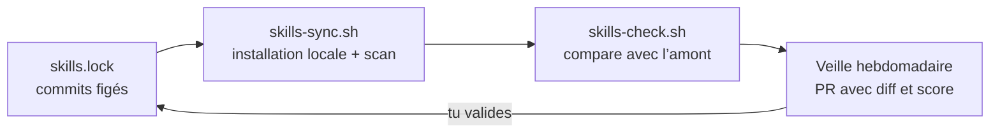

<!-- README — Dexty · @hopsyder — Nexus Partners -->

<div align="center">

<picture>
  <source media="(prefers-color-scheme: dark)" srcset="assets/dexty-logo-white.svg" />
  
</picture>

### L’équipe d’agents qui se souvient.

<a href="assets/dexty-presentation.mp4">
  
</a>

<sub>▶ <a href="assets/dexty-presentation.mp4">Voir la présentation complète (60 s, avec son)</a></sub>

<br /><br />

<a href="https://github.com/Hop-Syder/fullstack-agent-skills-2026/stargazers"></a>
<a href="docs/EVALUATION.md"></a>
<a href="skills.lock"></a>
<a href="https://github.com/NVIDIA/SkillSpector"></a>

</div>

<!--
  Vidéo complète jouable directement dans la page (optionnel) :
  1. Ouvre ce README en édition sur github.com.
  2. Glisse-dépose assets/dexty-presentation.mp4 dans l'éditeur.
  3. GitHub insère une ligne https://github.com/user-attachments/assets/… : garde-la seule sur sa ligne, ici.
  GitHub affiche alors un lecteur (lecture au clic : GitHub n'autorise pas la lecture automatique).
-->

---

## Pourquoi Dexty

Les agents de code ont quatre défauts qui coûtent cher sur un vrai projet :

| Défaut | Ce qui se passe | La réponse de Dexty |
|---|---|---|
| **Amnésie de session** | Ce qui a été refusé, arbitré ou validé est oublié à la session suivante. | Une mémoire de projet relue à chaque démarrage. |
| **Gaspillage de tokens** | L’agent charge des dépôts entiers d’outils inutiles pour le problème posé. | Un onboarding qui ne garde que les skills utiles. |
| **Mises à jour sauvages** | Les skills changent en amont et le comportement de l’agent dérive. | Chaque skill est figé sur un commit précis. |
| **Auto-évaluation** | L’agent qui écrit le code se note lui-même et ne voit pas ses failles. | Un agent QA séparé, qui n’a pas codé. |

Dexty est conçu par **[Nexus Partners](https://nexus-partners.xyz/)**, sous la direction de **[@Hop-Syder](https://github.com/Hop-Syder)**.

---

## Ce qui rend Dexty différent

**1. Un onboarding sur mesure en 7 questions.** Dexty analyse ta stack, ton horizon et la sensibilité de tes données, puis sélectionne uniquement les skills nécessaires. Exemple : 26 skills sur 37 pour un SaaS Next.js + Supabase.

**2. Un lock déterministe.** [`skills.lock`](skills.lock) fige chaque skill sur un commit SHA exact. Aucune mise à jour silencieuse.

**3. Un garde-fou de sécurité.** Tout skill tiers passe par [NVIDIA SkillSpector](https://github.com/NVIDIA/SkillSpector) avant installation (injection de prompt, exfiltration, permissions).

**4. Un juge séparé de l’exécutant.** L’agent QA note la qualité et la conformité du travail sans y avoir participé.

**5. Une mémoire qui garde la vision.** Au démarrage, l’agent relit [`.project-memory/`](.project-memory/), annonce où on en est, et refuse ce qui sort de la vision du projet tant que tu ne l’as pas convaincu.

---

## Les 8 agents

| # | Agent | Mission | Fiche |
|---|---|---|---|
| ① | **Product Manager** | Cadrage du besoin, spécifications, découpage en tâches, décisions d’architecture (ADR) | [`01-product-manager.md`](agents/01-product-manager.md) |
| ② | **Workflow / UX Owner** | Parcours utilisateur, design tokens, enchaînement des écrans, contrats d’API côté front | [`02-workflow-ux-owner.md`](agents/02-workflow-ux-owner.md) |
| ③ | **Security Lead** | Modèle de menaces STRIDE, durcissement du code, contrôle des permissions des agents | [`03-security-lead.md`](agents/03-security-lead.md) |
| ④ | **Build / Dev Lead** | Développement incrémental, TDD, simplification, débogage | [`04-build-dev-lead.md`](agents/04-build-dev-lead.md) |
| ⑤ | **DevOps / Release** | CI/CD, conteneurs durcis, observabilité | [`05-devops-release.md`](agents/05-devops-release.md) |
| ⑥ | **QA / Evaluator** | Mesure indépendante de la qualité et de la conformité | [`06-qa-evaluator.md`](agents/06-qa-evaluator.md) |
| ⑦ | **Data / ML** | Données tabulaires, PostgreSQL, modèles ML/NLP, suivi de dérive | [`07-data-ml.md`](agents/07-data-ml.md) |
| ⑧ | **Project Memory** | Mémoire du projet, rappel des décisions passées, protection de la vision | [`08-project-memory.md`](agents/08-project-memory.md) |

Chaque agent principal délègue à des sous-agents spécialisés. La correspondance complète agent → skills est dans [`docs/MAPPING.md`](docs/MAPPING.md).

---

## La chaîne des skills : rien ne bouge sans toi



- Un skill est téléchargé une seule fois, puis utilisé en local. Jamais d’appel à GitHub pendant le travail.
- Aucun skill n’est installé sans scan de sécurité réussi.
- Aucune mise à jour n’est appliquée sans ta validation dans une Pull Request.
- Seuls les skills inscrits dans le lock sont chargés.

---

## Démarrage rapide

**1. Récupérer Dexty**

```bash
git clone https://github.com/Hop-Syder/fullstack-agent-skills-2026.git ~/fullstack-agent-skills-2026
```

**2. L’installer dans ton projet et lancer l’onboarding**

```bash
~/fullstack-agent-skills-2026/install.sh /chemin/vers/mon-projet --onboard
```

Les 7 questions :

1. Nom du projet
2. Description courte
3. Stack technique (ex. Next.js + Postgres + Tailwind)
4. Fonctionnalités prioritaires (auth, dashboard, paiement, API…)
5. Horizon : MVP, produit soigné ou entreprise
6. Exposition publique sur Internet (renforce la sécurité)
7. Données sensibles (active les skills d’audit Trail of Bits)

**3. Démarrer**

```bash
cd /chemin/vers/mon-projet
claude   # ou codex, cursor, VS Code
```

L’agent Project Memory se réveille, charge la carte du projet (`MAP.md`), affiche où on en est et veille sur la vision.

Guide détaillé par outil (Claude Code, VS Code, Codex, OpenClaw…) : [`INSTALL.md`](INSTALL.md).

---

## Évaluation de l’architecture

Notée sur 100 selon la grille de [`docs/EVALUATION.md`](docs/EVALUATION.md) :

| Axe | Note | Justification |
|---|---:|---|
| Couverture du cycle | 20/20 | Définir → planifier → coder → vérifier → relire → livrer, plus Data/ML et mémoire |
| Séparation des rôles | 20/20 | Le juge QA est distinct de l’exécutant. Aucun doublon. |
| Traçabilité des skills | 18/20 | Sources vérifiées. 2 skills Data/ML encore à sourcer. |
| Orchestration | 17/20 | Délégation multi-agents fondée sur obra/superpowers |
| Évaluabilité | 14/20 | Grille et agent QA en place. L’évaluation en conditions réelles viendra avec l’installation des skills. |
| **Total** | **89/100** | **Architecture solide, prête à passer à l’implémentation** |

Les 11 points restants se gagnent en installant les skills et en évaluant l’agent sur de vrais projets.

---

## Organisation du dépôt

```text
fullstack-agent-skills-2026/
├── README.md                 # cette page
├── AGENTS.md                 # instructions lues par tous les agents de code
├── CLAUDE.md                 # import d’AGENTS.md pour Claude Code
├── INSTALL.md                # guide d’installation par outil
├── install.sh                # installation dans un projet (n’écrase rien)
├── skills.catalog.json       # catalogue des 37 skills et de leurs déclencheurs
├── skills.lock               # skills figés : commit, date et score de scan
├── tools/
│   ├── onboard.sh            # les 7 questions et la sélection des skills
│   ├── skills-sync.sh        # installation locale + scan SkillSpector
│   └── skills-check.sh       # vérification des mises à jour en amont
├── .github/workflows/
│   ├── skills-update.yml     # veille hebdomadaire + PR automatique
│   └── sdlc-pipeline.yaml    # pipeline de livraison multi-agents
├── agents/                   # fiches des 8 agents
├── docs/
│   ├── MAPPING.md            # agents → skills
│   ├── SOURCES.md            # dépôts sources vérifiés
│   └── EVALUATION.md         # grille de notation sur 100
├── assets/                   # logo, icônes, vidéo et GIF de présentation
├── .project-memory/          # mémoire du projet (MAP, STATE, REFUSALS…)
└── skills/                   # skills de référence
```

---

## Benchmark — Version 3.5.0 (2026-10-13)

| Métrique | Résultat | Détail |
|----------|---------|--------|
| **Skills dans le catalogue** | 37 | Couvrant 8 agents spécialisés |
| **Skills installables (lock)** | 51 | Après sélection contextuelle (onboarding) |
| **Onboarding → sélection** | ✅ OK | 7 questions → sélection automatique (14–26 skills selon le projet) |
| **skills-sync.sh** | ✅ OK | Installation locale + scan (SkillSpector si disponible) |
| **Mémoire projet** | ✅ OK | MAP, STATE, REFUSALS, ERRORS, DECISIONS — relus à chaque session |
| **Protection MAP.md** | ✅ OK | L'onboarding ne l'écrase plus si déjà renseigné |
| **Licence** | AGPL-3.0 | Protection IP + possibilité de dual licensing |
| **Score architecture** | 89/100 | Voir [`docs/EVALUATION.md`](docs/EVALUATION.md) |
| **Version des agents** | Desty 3.5 | Cohérence vérifiée dans les 8 fiches |

### Changelog v3.5.0

- ✅ Licence AGPL-3.0 ajoutée
- ✅ MAP.md : vision, périmètre, architecture, principes non négociables
- 🐛 Fix : `onboard.sh` n'écrase plus MAP.md si déjà renseigné
- 🐛 Fix : version "Desty 3.2" → "Desty 3.5" dans tous les agents et docs
- 🐛 Fix : `selected_at` utilise la date du jour au lieu d'un hardcode
- ✅ `skills-sync.sh` : 51 skills synchronisés avec succès
- ✅ Onboarding testé : sélection contextuelle fonctionnelle (14 à 26 skills selon le stack)

---

## Sources et remerciements

Dexty s’appuie sur le travail open source de :

- [addyosmani/agent-skills](https://github.com/addyosmani/agent-skills) — Addy Osmani
- [obra/superpowers](https://github.com/obra/superpowers) — Jesse Vincent
- [anthropics/skills](https://github.com/anthropics/skills) — Anthropic
- [trailofbits/skills](https://github.com/trailofbits/skills) — Trail of Bits
- [vercel-labs/agent-skills](https://github.com/vercel-labs/agent-skills) — Vercel Labs
- [supabase/agent-skills](https://github.com/supabase/agent-skills) — Supabase
- [NVIDIA/SkillSpector](https://github.com/NVIDIA/SkillSpector) — NVIDIA (scanner de sécurité)

---

<div align="center">
  <picture>
    <source media="(prefers-color-scheme: dark)" srcset="assets/dexty-mark-white.svg" />
    
  </picture><br />
  <sub>Conçu et maintenu par <b><a href="https://github.com/Hop-Syder">ISMAEL CHRISTIAN DAOUDA ABASSI (@Hop-Syder)</a></b> · <b><a href="https://nexus-partners.xyz/">Nexus Partners</a></b></sub>
</div>
