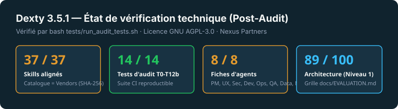

<div align="center">
  <picture>
    <source media="(prefers-color-scheme: dark)" srcset="assets/dexty-logo-white.svg" />
    
  </picture>

  <h3>Un framework open source d'agents de code à mémoire persistante</h3>

  <p>
    <b>Sélection contextuelle</b> · <b>Verrouillage déterministe (SHA-1 & SHA-256)</b> · <b>Mémoire projet relue à chaque session</b> · <b>Évaluation QA indépendante</b>
  </p>

  <p>
    <a href="LICENSE"></a>
    <a href="VERSION"></a>
    <a href="skills.catalog.json"></a>
    <a href="agents/"></a>
  </p>
</div>

## Le problème

Les agents de code actuels (Claude Code, Codex, Cursor, VS Code Copilot) sont efficaces sur un prompt isolé, mais rencontrent **4 limites structurelles** sur des projets de longue durée :

1. **Amnésie de session** — À chaque réveil, l'agent repart de zéro, oublie les choix d'architecture et ignore ce qui a déjà été refusé.
2. **Gaspillage de tokens** — Charger des dizaines de skills génériques sature la fenêtre de contexte et dilue l'attention du modèle.
3. **Mises à jour sauvages** — Télécharger un skill tiers sur `main` sans contrôle d'intégrité expose le projet aux régressions et aux injections de prompt.
4. **Auto-évaluation biaisée** — L'agent qui produit le code est le même qui juge son travail.

## La solution Dexty 3.5.1

**Dexty Agent Skills** structure le cycle de développement autour de 4 mécanismes vérifiables :

- **Mémoire persistante (`.project-memory/`)** — Livrée sous forme de templates vierges (`MAP.md`, `STATE.md`, `REFUSALS.md`, `ERRORS.md`, `DECISIONS.md`, `SUCCESSES.md`), remplie lors de l'onboarding et relue automatiquement au démarrage de session via `.claude/hooks/memory-wake.sh`.
- **Sélection contextuelle (`tools/onboard.sh`)** — Un questionnaire en 7 questions sélectionne entre 14 et 26 skills pertinents parmi les 37 du catalogue (`skills.catalog.json`).
- **Verrouillage déterministe (`tools/skills-sync.sh`)** — Génère `.agents/skills.lock` avec le commit SHA amont (40 caractères) et l'empreinte cryptographique `SHA-256` de chaque skill. Tout échec de téléchargement, d'empreinte ou de politique de sécurité provoque un arrêt franc (`exit 1`), sans jamais fabriquer de fichier de substitution.
- **Juge QA séparé (`agents/06-qa-evaluator.md`)** — Sépare strictement les rôles d'exécution et d'évaluation selon la grille de [`docs/EVALUATION.md`](docs/EVALUATION.md).

## Les 8 agents spécialisés

| Agent | Fiche & Tag `@` | Rôle principal | Mémoire & outils consultés |
| :--- | :--- | :--- | :--- |
| **① Product Manager** | `@agents/01-product-manager.md` ([fiche](agents/01-product-manager.md)) | Spécifications, périmètre MVP & décisions (ADR) | `.project-memory/MAP.md`, `DECISIONS.md` |
| **② Workflow / UX Owner** | `@agents/02-workflow-ux-owner.md` ([fiche](agents/02-workflow-ux-owner.md)) | Parcours utilisateur, composants UI & contrats d'API | `skills.catalog.json` |
| **③ Security Lead** | `@agents/03-security-lead.md` ([fiche](agents/03-security-lead.md)) | Modélisation des menaces, revue de diffs & garde-fous | `.project-memory/ERRORS.md`, `REFUSALS.md` |
| **④ Build / Dev Lead** | `@agents/04-build-dev-lead.md` ([fiche](agents/04-build-dev-lead.md)) | Implémentation incrémentale, TDD & débogage | `.agents/skills.lock` |
| **⑤ DevOps / Release** | `@agents/05-devops-release.md` ([fiche](agents/05-devops-release.md)) | CI/CD, observabilité, performance & déploiement | `.github/workflows/skills-update.yml` |
| **⑥ QA / Evaluator** | `@agents/06-qa-evaluator.md` ([fiche](agents/06-qa-evaluator.md)) | Évaluation indépendante (le juge ne code jamais) | `docs/EVALUATION.md`, `ERRORS.md` |
| **⑦ Data / ML** | `@agents/07-data-ml.md` ([fiche](agents/07-data-ml.md)) | Modélisation SQL/PostgreSQL, données tabulaires & pipelines | `skills.catalog.json` |
| **⑧ Project Memory** | `@agents/08-project-memory.md` ([fiche](agents/08-project-memory.md)) | Gardien de la vision et reprise de session | `.project-memory/*`, `.claude/hooks/memory-wake.sh` |

> 💡 **Comment invoquer un agent dans votre chat :** Mentionnez directement son fichier avec `@` (ex: `@agents/01-product-manager.md voici mon idée...`). Le Product Manager analysera votre tâche et la déléguera aux autres agents.

## Démarrage rapide

```bash
# 1. Cloner le dépôt Dexty
git clone https://github.com/Hop-Syder/Dexty-agent-skills-2026.git ~/Dexty-agent-skills-2026

# 2. Installer Dexty dans votre projet et lancer l'onboarding (7 questions)
~/Dexty-agent-skills-2026/install.sh /chemin/vers/mon-projet --onboard

# 3. Ouvrir votre projet avec Claude Code (ou Cursor / Codex / VS Code)
cd /chemin/vers/mon-projet
claude
```

Guide détaillé par outil : [`INSTALL.md`](INSTALL.md).

## Organisation du dépôt

```text
Dexty-agent-skills-2026/
├── VERSION                 # version unique du framework (3.5.1)
├── LICENSE                 # licence GNU AGPL-3.0
├── README.md               # présentation et architecture
├── AGENTS.md               # instructions de session universelles
├── CLAUDE.md               # point d'entrée Claude Code (@AGENTS.md)
├── INSTALL.md              # guide d'installation par éditeur/CLI
├── install.sh              # installateur idempotent (--onboard / --skip-onboard)
├── skills.catalog.json     # catalogue des 37 skills (commit SHA + SHA-256)
├── tools/
│   ├── onboard.sh          # questionnaire en 7 étapes → MAP.md + .agents/skills.lock
│   ├── skills-sync.sh      # installation atomique + vérification SHA-256 / SkillSpector
│   └── skills-check.sh     # comparaison des commits amont par chemin (statut UNKNOWN hors-ligne)
├── .claude/
│   ├── settings.json       # déclaration du hook SessionStart
│   ├── commands/resume.md  # commande /resume
│   └── hooks/memory-wake.sh# réveil mémoire et détection de nouveau projet
├── .github/workflows/
│   └── skills-update.yml   # suite de tests CI (T1-T12b) + veille amont hebdomadaire
├── agents/                 # 8 fiches d'agents (01 à 08)
├── docs/
│   ├── MAPPING.md          # cartographie agents → skills
│   ├── SOURCES.md          # dépôts amont documentés
│   └── EVALUATION.md       # grille d'évaluation architecturale (Niveau 1 : 89/100 sur papier)
├── skills/                 # 37 résumés opérationnels vendored (vérifiés par SHA-256)
├── tests/
│   └── run_audit_tests.sh  # suite de tests automatisés de non-régression (T1 à T12b)
├── assets/                 # logos SVG/PNG (Piste A), benchmark SVG et vidéo MP4 1080p
└── .project-memory/        # templates vierges copiés dans les nouveaux projets
```

## Vérification et tests automatisés

<div align="center">
  
</div>

Pour exécuter la suite de tests de sécurité et de non-régression en local (14 tests couvrant les scénarios `T1` à `T12b` en bac à sable isolé) :

```bash
bash tests/run_audit_tests.sh
```

| Vérification | Résultat | Preuve / Mécanisme |
| :--- | :--- | :--- |
| **Cohérence catalogue ↔ `skills/`** | **43 / 43** | Invariant vérifié par `tests/run_audit_tests.sh` (`commit` + `sha256` présents sur chaque entrée) |
| **Parcours `install.sh --onboard` (`T1`, `T4`)** | **Testé** | Génère `.agents/skills.lock` et initialise `.project-memory/MAP.md` avec les réponses du projet |
| **Idempotence & hook (`T2`, `T3`, `T12b`)** | **Testé** | Aucune duplication de `AGENTS.md` ; `.claude/settings.json` copié ; template vierge détecté au réveil |
| **Protection contre injections (`T5`, `T11`)** | **Testé** | Aucun `os.system` (`subprocess.run(..., shell=False)`) ; passage par `os.environ` et heredoc quoté |
| **Intégrité supply-chain (`T6`, `T7a`, `T7b`)** | **Testé** | Aucun faux `SKILL.md` en cas d'échec réseau ; refus des scores bas ou dépôts non vérifiés avec `exit 1` |
| **Honnêteté du checker (`T8`, `T8b`)** | **Testé** | Compare le SHA verrouillé ; retourne `UNKNOWN` (`exit 2`) hors-ligne et `UNPINNED` (`exit 2`) sans commit |
| **Évaluation architecturale (Niveau 1)** | **89 / 100** | Grille conceptuelle documentée dans [`docs/EVALUATION.md`](docs/EVALUATION.md) |

### Changelog v3.5.1 (Remédiation d'audit)

- **Sécurité P0 (`AUD-001` à `AUD-004`)** : suppression totale du fallback générant de faux `SKILL.md` « APPROVED » ; vérification stricte d'empreinte `SHA-256` ; remplacement de tous les appels `os.system` par `subprocess.run(..., shell=False)` avec validation regex ; élimination de l'interpolation Python dans `tools/onboard.sh` via `os.environ`.
- **CI/CD P0 (`AUD-005`, `AUD-018`)** : workflow unifié dans `.github/workflows/skills-update.yml` avec actions épinglées par SHA et exécution automatique de `tests/run_audit_tests.sh`.
- **Mémoire & Installation P1 (`AUD-006` à `AUD-008`, `AUD-015`, `AUD-021`)** : support effectif de `--onboard` dans `install.sh`, copie de `.claude/settings.json`, idempotence de `AGENTS.md`, templates `.project-memory/` vierges avec marqueur unifié `DEXTY_TEMPLATE_UNCONFIGURED`, et suppression du lock global pré-armé.
- **Unification & Checker P1 (`AUD-009` à `AUD-014`, `AUD-016`, `AUD-017`)** : alignement strict `skills.catalog.json` ↔ `skills/` (37/37 skills avec `commit` et `sha256`), statut `UNKNOWN` (`exit 2`) en cas d'erreur réseau dans `tools/skills-check.sh`, et écriture atomique (`tempfile` + `os.replace`).

## Sources et crédits amont

Les 37 résumés opérationnels du dossier `skills/` sont des adaptations condensées pour Dexty 3.5.1 basées sur les dépôts open source suivants :

- [addyosmani/agent-skills](https://github.com/addyosmani/agent-skills) — Addy Osmani
- [obra/superpowers](https://github.com/obra/superpowers) — Jesse Vincent
- [anthropics/skills](https://github.com/anthropics/skills) — Anthropic
- [trailofbits/skills](https://github.com/trailofbits/skills) — Trail of Bits
- [vercel-labs/agent-skills](https://github.com/vercel-labs/agent-skills) — Vercel Labs
- [supabase/agent-skills](https://github.com/supabase/agent-skills) — Supabase
- [NVIDIA/SkillSpector](https://github.com/NVIDIA/SkillSpector) — NVIDIA (scanner de sécurité externe)

<div align="center">
  <picture>
    <source media="(prefers-color-scheme: dark)" srcset="assets/dexty-mark-white.svg" />
    
  </picture><br />
  <sub>Conçu et maintenu par <b><a href="https://github.com/Hop-Syder">ISMAEL CHRISTIAN DAOUDA ABASSI (@Hop-Syder)</a></b> · <b><a href="https://nexus-partners.xyz/">Nexus Partners</a></b></sub>
</div>
